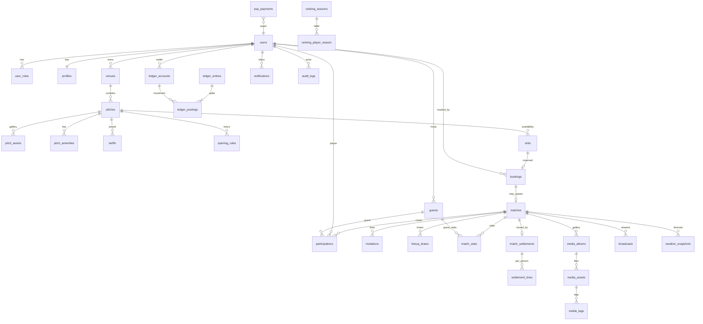

# Akademia Wielkich Piłkarzy — Vision & Product Architecture

**Wersja dokumentu:** 1.0  
**Status:** Etap 1 — decyzja architektoniczna (bez kodu)  
**Adresat:** CTO / Product / Engineering  
**Horyzont:** platforma komercyjna, 5–10 lat rozwoju, tysiące użytkowników, potem dziesiątki tysięcy  

Ten dokument opisuje **nową wersję** AWP jako produkt SaaS + marketplace, z zachowaniem wiedzy domenowej z obecnej aplikacji (składka dzielona przez liczbę zapisanych, zaokrąglenie do 0,50 zł, zaliczka, goście meczowi, sezony rankingowe, HotPay, panel partnera boiska).

---

## 0. Executive summary i decyzja nadrzędna

### 0.1 Co budujemy

AWP v2 to **dwufilarowa platforma sportowa**:

1. **Marketplace wynajmu boisk** — podaż (właściciele obiektów), popyt (gracze / organizatorzy), rezerwacja slotów, płatność, rozliczenie operatora z obiektem.
2. **Organizacja meczów społecznościowych** — tworzenie wydarzenia, zapisy (Gram / Nie gram / Zastanawiam się), goście, składy, ranking, galeria, transmisja, rozliczenie składki.

Oba filary spotykają się w jednym zdarzeniu biznesowym: **mecz na konkretnym slocie boiska, opłacony przez grupę graczy**.

### 0.2 Decyzja: Modular Monolith, nie mikroserwisy na starcie

**Wybór:** jeden proces Spring Boot (Java 21) + PostgreSQL + Redis + RabbitMQ (opcjonalnie od Fazy 2 jako wewnętrzna szyna), frontend Next.js, deploy Docker na VPS Linux za Nginx.

**Granice modułów** (pakiety / bounded contexts) są twarde od dnia 1. **Procesy i bazy** pozostają wspólne do momentu, gdy konkretny kontekst ma inny cykl życia, skalę lub zespół.

Kandydaci do **późniejszego wydzielenia** (w tej kolejności):

1. Payments + Ledger  
2. Notifications  
3. Fields Booking (availability / locking)  
4. Matches (jeśli ruch społecznościowy zdominuje marketplace)

**Uzasadnienie (CTO):**

| Kryterium | Mikroserwisy od dnia 1 | Modular Monolith |
|---|---|---|
| Koszt VPS / ops | 4–8 JVM, mesh, wiele DB | 1 JVM + Postgres + Redis |
| Czas do MVP | 3–6 mies. na szkielet | 6–10 tyg. na szkielet + pierwszy vertical |
| Transakcje (składka, slot, zapis) | saga / outbox od razu | lokalna transakcja + outbox |
| Ryzyko spójności finansowej | wysokie | kontrolowane (ledger w tym samym commit) |
| Zespół | wymaga platform team | 1–3 osoby mogą dowieźć produkt |

Przy Twoim zakresie (pieniądze, korekty, goście, ranking, media) **spójność transakcyjna jest cenniejsza niż niezależne skalowanie**. Mikroserwisy bez ruchu i bez osobnych zespołów to koszt stały, nie dźwignia.

Szacunek kosztów startowych (orientacyjny, PL, 2026):

- Modular monolith na 1 VPS 4–8 vCPU / 8–16 GB: **70–150 EUR/mies.** + storage + SMTP + HotPay prowizja.
- 5–6 mikroserwisów + 3 bazy + broker HA: **400–900 EUR/mies.** zanim pojawi się produkt-market fit.

Oszczędność 70–90% na starcie jest realna. **Nie rezygnujemy z architektury rozproszonej — odkładamy ją za mierzalny próg** (patrz Faza 4).

### 0.3 Zasady nienegocjowalne

1. **Pieniądze nigdy nie są polem `balance` aktualizowanym in-place.** Saldo = projekcja z księgi (ledger).
2. **Kwoty wyłącznie w groszach (`BIGINT`), waluta `PLN`.** Żadnego `FLOAT` / `DOUBLE` w finansach.
3. **Idempotencja** na wszystkich webhookach (HotPay), zapisach, korygowaniach składki.
4. **Slot boiska jest zasobem concurrency** — optimistic locking + unikalny constraint czasu.
5. **Gość nie jest użytkownikiem.** Gość to uczestnik meczu powiązany z hostem; konto powstaje dopiero przy konwersji.
6. **Cena na osobę jest zawsze wyliczana, nigdy wpisywana ręcznie jako źródło prawdy** (źródło: koszt wynajmu + polityka zaokrągleń + liczba płatników).
7. **RBAC + audit log** na każdą mutację admin/owner/organizer.
8. **Frontend nie jest źródłem prawdy biznesowej.** Next.js orkiestruje UX; reguły żyją w Spring.

---

## 1. Analiza biznesowa

### 1.1 Problem rynkowy

W Polsce wynajem boisk i amatorskie mecze są rozproszone: Facebook, grupy WhatsApp, telefon do orlika, gotówka na miejscu, Excel organizatora. Skutki:

- Brak wiarygodnej dostępności (double booking).
- Niejasna składka (12 vs 14 osób).
- Brak historii płatności i reputacji gracza.
- Właściciel obiektu nie ma kanału sprzedaży 24/7.
- Organizator traci czas na windykację i listy.

AWP łączy **podaż infrastruktury** z **popytem społeczności** i **rozliczeniem grupowym**.

### 1.2 Persona i jobs-to-be-done

| Persona | Job | Sukces | Lęk |
|---|---|---|---|
| Gracz | Zagrać regularnie, mieć skład, płacić uczciwie | Slot potwierdzony, składka jasna, ranking | No-show innych, zmiana ceny, kłótnie o pieniądze |
| Organizator | Zebrać ludzi i opłacić boisko | Pełny skład, pieniądze zebrane, zero ręcznej księgowości | Dziura w składce, last-minute rezygnacje |
| Właściciel boiska | Sprzedać puste godziny | Kalendarz zapełniony, payout na czas | No-show, spory, opóźnione przelewy |
| Super Admin / operator AWP | Marża, zaufanie, zgodność | Provizja, niski chargeback, NPS | Oszustwa, AML, utrata płynności |
| Gość (bez konta) | Jednorazowo zagrać z kumplem | Wejście na listę bez rejestracji | Spam, brak kontroli nad danymi |

### 1.3 Model biznesowy (komercjalizacja)

**Strumienie przychodu (kolejność wdrożenia):**

1. **Take-rate od rezerwacji boiska** — % od kwoty wynajmu lub opłata stała / slot (Faza 3).
2. **Take-rate od składek meczowych** online (HotPay) — część pokrywa już zaokrąglenie do 0,50 zł (dziedzictwo obecnego AWP).
3. **Abonament właściciela obiektu** — listing, wyróżnienie na mapie, analityka (Faza 3/4).
4. **Boost / featured pitch** — płatne pozycjonowanie (Faza 4).
5. **Transmisje / VOD** — freemium + storage pass-through lub pakiet klubowy (Faza 4; świadomie drogi).
6. **B2B akademie / firmy** — prywatne ligi, white-label sezonów (później).

**Świadomie poza core MVP:** marketplace sprzętu, zakłady, tokenizacja, crypto.

### 1.4 Jednostki ekonomiczne

- **Pitch-hour** — atom podaży marketplace.
- **Match** — atom popytu społeczności (może, ale nie musi, konsumować pitch-hour przez booking).
- **Participation** — atom rozliczenia (gracz lub gość hosta).
- **Ledger entry** — atom księgowy (nie mylić z płatnością PSP).
- **Payout** — atom rozliczenia z właścicielem boiska / organizatorem.

### 1.5 Kluczowe ryzyka biznesowe (i odpowiedź produktu)

| Ryzyko | Mechanizm |
|---|---|
| Zmienna składka (12→14 osób) | Snapshot policy + korekty ledger + komunikacja przed kickoff |
| No-show | Zaliczka, policy odwołania, reputacja, waitlist auto-promote |
| Double booking | Unikalność slotu + hold TTL + potwierdzenie płatności |
| Gość bez odpowiedzialności | Host jest dłużnikiem za gościa |
| Spór o MVP / gole | Okno edycji statystyk + audit + freeze sezonu |
| Płatność gotówką / BLIK na telefon | Statusy `OFF_PLATFORM` + potwierdzenie organizatora, **nie** mieszać z saldem PSP |
| Płynność operatora | Segregacja środków: wallet gracza vs escrow meczu vs payable obiektu |
| Koszt streamingu | Feature flag, BYO ingest (YouTube/Twitch) w Fazie 2, native VOD dopiero przy przychodzie |

### 1.6 Relacja do obecnego AWP (brownfield knowledge)

Obecna aplikacja (Next.js, SQLite/Turso) już zna:

- składkę = wynajem / liczba zapisanych, ceil do 0,50 PLN,
- zaliczkę przed meczem (dziś 25 PLN),
- gości, losowanie składów / kapitanów,
- portfel, depozyty HotPay, transakcje,
- marketplace boisk i panel partnera,
- sezony rankingowe.

v2 **nie kopiuje schematu SQLite**. Przenosi reguły do jawnnego modelu księgowego i RBAC, z PostgreSQL jako systemem zapisu.

GymBrat pozostaje **osobną aplikacją** (cross-link / embed). v2 AWP nie wchłania GymBrat.

### 1.7 Wymagania niefunkcjonalne (NFR)

| NFR | Cel start (Faza 3) | Cel skala (Faza 4) |
|---|---|---|
| Użytkownicy | 5–15k zarejestrowanych | 50k+ |
| Concurrent match signups | 200 RPS szczyt wieczorny | 2k RPS z kolejką |
| Booking lock | p95 < 150 ms | p95 < 80 ms |
| RPO | 24 h (backup VPS) | 15 min WAL + offsite |
| RTO | 4 h | 30–60 min |
| Dostępność | 99.5% | 99.9% |
| Locale | pl-PL, IANA `Europe/Warsaw` | + en później |
| Retention mediów | 12 mies. galeria | polityka tiered (hot/cold) |

---

## 2. Architektura systemu

### 2.1 Styl: Modular Monolith + hexagonal adapters

```
                    ┌─────────────────────────────────────────┐
   Next.js          │  BFF / UI  (App Router, RSC, TanStack)  │
   Tailwind         │  Zustand = UI state only                 │
                    └──────────────────┬──────────────────────┘
                                       │ HTTPS / JSON
                    ┌──────────────────▼──────────────────────┐
   Nginx            │  TLS, gzip, static, rate-limit edge      │
                    └──────────────────┬──────────────────────┘
                                       │
                    ┌──────────────────▼──────────────────────┐
                    │         Spring Boot 3.x (Java 21)         │
                    │  ┌──────────── API (REST, OpenAPI) ─────┐ │
                    │  │  application services (use-cases)    │ │
                    │  │  domain modules (packages)           │ │
                    │  │  adapters: JPA, Redis, SMTP, HotPay  │ │
                    │  └──────────────────────────────────────┘ │
                    │         Spring Security (JWT + RBAC)      │
                    └─────┬──────────┬──────────┬──────────────┘
                          │          │          │
                    PostgreSQL     Redis     RabbitMQ
                    (SoT)        (cache,     (async from
                                  locks,      Faza 2)
                                  sessions)
```

**Hexagon:** domena nie zna HotPay, Leaflet, SMTP. Adaptery implementują porty (`PaymentGateway`, `WeatherProvider`, `NotificationSender`, `ObjectStorage`, `StreamProvider`).

### 2.2 Podział frontend / backend

| Warstwa | Technologia | Odpowiedzialność | Czego nie robi |
|---|---|---|---|
| Web | Next.js + TS + Tailwind | SEO landing, mapa, SSR wizytówek, dashboardy | Wyliczanie składek, lock slotu |
| Client cache | TanStack Query | Fetch, invalidation, optimistic UI z rollback | Source of truth |
| Client store | Zustand | Filtry mapy, wizard rezerwacji, draft UX | Tokeny w localStorage bez rotacji |
| API | Spring MVC / WebFlux MVC | Use-case, walidacja, authz | Render HTML |
| DB | PostgreSQL 16 | Relacje, constraints, ledger | Logika w triggerach poza audytem |
| Cache | Redis 7 | Geo cache, availability snapshots, rate limit, refresh tokens denylist | Saldo jako jedyna kopia |
| Jobs | Spring Scheduler + (Faza 2) Rabbit | Reminders, weather refresh, settlement close, ranking freeze | UI thread |

Mapy: **OpenStreetMap + Leaflet** po stronie frontu. Backend serwuje GeoJSON / bounding-box query (`venues` z `GEOGRAPHY(Point, 4326)`). Nie używamy Google Maps (koszt + ToS).

### 2.3 Runtime na VPS

Pojedynczy host (Faza 1–3), Compose:

- `nginx` (80/443)
- `api` (Spring, 8080 internal)
- `web` (Next.js standalone) **albo** static export + API-only — rekomendacja: Next.js SSR za Nginx `/` i `/api/bff` tylko jeśli potrzeba; **preferowane:** Next woła Spring bezpośrednio `/api/v1`.
- `postgres`
- `redis`
- `prometheus` + `node-exporter` + `postgres-exporter`
- `loki` + `promtail`
- `grafana`
- `rabbitmq` od Fazy 2 (do Fazy 1: Spring events in-process + transactional outbox table)

**Uzasadnienie Next + Spring:** Next zostaje, bo już jest kompetencją zespołu AWP (SEO, mapa, PWA). Java przejmuje **rdzeń transaktyjny**, którego SQLite/Turso i Route Handlery nie uniosą przy marketplace + ledger.

### 2.4 Wzorce obowiązkowe w monolicie

1. **Package-by-module**, nie package-by-layer globalnie.  
   Przykład: `com.awp.booking.domain`, `com.awp.booking.api`, `com.awp.booking.infra`.
2. **Zakaz importów między domain packages** — komunikacja przez application services / events.
3. **Transactional Outbox** — nawet bez RabbitMQ: tabela `outbox_event`, publisher in-process, później podmiana na AMQP.
4. **Optimistic locking** (`version`) na `booking_slot`, `match`, `wallet_account`.
5. **Clock port** — testowalny czas; biznes w `Europe/Warsaw`.
6. **Feature flags** w DB (`app_setting`) dla marketplace, streamingu, płatności testowych.

### 2.5 Kiedy rozbić na serwisy (kryteria, nie data)

Wydziel moduł **tylko** gdy spełnione ≥2:

- Inny zespół i sprint cadence.
- Inny profil obciążenia (np. webhooks PSP vs CRUD boisk).
- Potrzeba niezależnego deploy bez downtime reszty.
- Limit pionowego skalowania VPS przekroczony przez 2+ kwartały.

Nie wydzielamy „bo czystość”.

---

## 3. Moduły biznesowe

### 3.1 Mapa bounded contexts

```
 Identity & Access          Catalog (Venues/Pitches)
        │                           │
        │                           ▼
        │                     Booking & Availability
        │                           │
        ├──────────────► Match Organization ◄── Community (Players/Guests)
        │                           │
        │              ┌────────────┼────────────┐
        │              ▼            ▼            ▼
        │           Ranking      Media        Streaming
        │              │         Gallery         │
        │              └────────────┬────────────┘
        │                           ▼
        └────────────────► Finance (Ledger + Wallet + PSP)
                                    │
                           Settlement / Payouts
                                    │
                           Notifications │ Weather │ Admin │ Analytics
```

### 3.2 Katalog modułów

| ID | Moduł | Odpowiedzialność | Dane własne | Zależności (czyta) | Publikuje eventy |
|---|---|---|---|---|---|
| M01 | Identity | Rejestracja, JWT, role, sesje, PIN/2FA później | users, credentials, roles | — | `UserRegistered`, `RoleChanged` |
| M02 | Profiles | Profil gracza, avatar, prywatność | profiles | Identity | `ProfileUpdated` |
| M03 | Catalog | Obiekty, boiska, zdjęcia, amenity, cennik, godziny | venues, pitches, assets, tariffs | Identity | `PitchPublished` |
| M04 | Booking | Kalendarz, sloty, hold, rezerwacja, cancel policy | slots, bookings | Catalog, Finance | `SlotHeld`, `BookingConfirmed`, `BookingCancelled` |
| M05 | Matches | Cykl życia meczu, zapisy, waitlist, zaproszenia, goście | matches, participations | Identity, Booking | `MatchCreated`, `SignupChanged` |
| M06 | Lineups | Losowanie drużyn, kapitanowie, formacje | lineup_draws | Matches | `LineupDrawn` |
| M07 | Stats | Gole, asysty, MVP, dystans, czyste konta | match_stats | Matches, Profiles | `StatsSubmitted` |
| M08 | Ranking | Sezony, scoring, tabele, snapshoty | ranking_* | Stats, Matches | `SeasonFrozen` |
| M09 | Ledger | Księga podwójna, konta, posting | accounts, journal | Identity | `Posted` |
| M10 | Wallet | Projekcja salda gracza, bonusy | wallet_views, holds | Ledger | — |
| M11 | Payments | HotPay, BLIK-on-us vs off-platform, cash | psp_payments | Ledger | `PaymentSucceeded` |
| M12 | Settlement | Składka meczowa, korekty, payout obiektu | match_settlements | Matches, Booking, Ledger | `SettlementClosed` |
| M13 | Media | Albumy, photo/video, tagi graczy | media_assets, tags | Matches, Identity | `MediaUploaded` |
| M14 | Streaming | Live, VOD, archiwum metadanych | broadcasts | Matches | `BroadcastStarted` |
| M15 | Weather | Snapshot + forecast per match/pitch | weather_snapshots | Matches, Catalog | — |
| M16 | Notifications | Email, in-app, web push | notification_*, templates | wszystkie | — |
| M17 | Admin | Moderacja, override, feature flags | admin_actions (audit) | wszystkie | — |
| M18 | Analytics | Funnel, GMVs, owner reports | read models | Ledger, Booking | — |

**Modular monolith mapping:** każdy `Mxx` = pakiet Javy + zestaw tabel. **Nie** osobny deployable.

### 3.3 Relacje (kontrakty)

- **Catalog → Booking:** pitch ma timezone, grid slotów (np. 60 min), `min_notice`, `buffer`.
- **Booking → Matches:** mecz **może** mieć `booking_id` (mecze na naszym marketplace) albo `external_venue_note` (mecz społecznościowy bez płatności AWP za boisko).
- **Matches → Settlement:** freeze listy płatników w `T_close` (np. kickoff − 30 min lub ręcznie przez organizatora).
- **Settlement → Ledger:** jedyne miejsce, które tworzy postings składki / korekty / refund.
- **Payments → Ledger:** PSP sukces = `DEBIT psp_clearing / CREDIT user_wallet` (lub bezpośrednio escrow).
- **Stats → Ranking:** ranking nigdy nie czyta UI; tylko zatwierdzone `match_stats` po `stats_lock_at`.
- **Guests:** należą do Matches; dług finansowy należy do `host_user_id` w Settlement.

### 3.4 Integracje zewnętrzne

| System | Kierunek | Wzorzec | Uwagi |
|---|---|---|---|
| HotPay | API + webhook | Adapter + idempotency key | Źródło prawdy o autoryzacji karty/BLIK on-platform |
| SMTP | out | retry + DLQ | transactional mail only (nie marketing blast z tej samej kolejki) |
| Web Push (VAPID) | out | Notifications | zgoda RODO |
| OpenStreetMap tiles | browser | Leaflet | respektować tile usage policy; własny tile proxy na skali |
| Weather (np. Open-Meteo) | in | cache Redis 15–30 min | brak kosztów licencyjnych jak u płatnych aggregatorów |
| Object storage (S3-compatible: Hetzner/OVH/Cloudflare R2) | media/VOD | presigned URL | **nie** dysk VPS na zdjęcia |
| YouTube/Twitch (Faza 2) | embed | BYO stream | unika native CDN na starcie |
| Grafana/Prometheus/Loki | ops | scrape / push logs | ten sam Compose |
| GymBrat | link/iframe | env URL | poza bounded context AWP |

### 3.5 Uzasadnienie cięcia modułów

Cięcie nie jest „jedna tabela = jeden mikroserwis”. Cięcie wynika z **inne źródło prawdy i inny cykl życia**:

- Catalog zmienia się rzadko, Booking ma wyścigi.
- Matches ma social graph, Ledger ma niezmienność.
- Media jest ciężkie I/O, Ranking jest CPU + batch.
- Notifications jest failure-tolerant, Settlement nie.

Dlatego pakiety są osobne, a baza jedna — **shared database, not shared domain**.

---

## 4. Główny moduł 1 — Marketplace boisk

### 4.1 Obiekty domenowe

- **Venue** — obiekt (adres, geo, właściciel, status weryfikacji).
- **Pitch** — konkretne boisko (wymiary, nawierzchnia, oświetlenie, indoor/outdoor).
- **PitchAsset** — zdjęcie/wideo w galerii (kolejność, cover).
- **Amenity** — słownik (prysznice, parking, szatnia, automat z wodą, trybuny…).
- **Tariff** — cennik: dzień tygodnia, przedział godzin, cena brutto, ewentualnie sezon.
- **OpeningRule** — godziny otwarcia + wyjątki (święta).
- **Slot** — instancja czasu do rezerwacji (generowana lub wirtualna).
- **Booking** — rezerwacja slotu przez organizatora / gracza / właściciela (blokada).

### 4.2 Cykl życia Pitch

`DRAFT → SUBMITTED → UNDER_REVIEW → PUBLISHED → SUSPENDED → ARCHIVED`

Usuwanie: **soft delete** (`ARCHIVED`). Twarde usunięcie tylko gdy brak historycznych bookingów (inaczej naruszenie księgowości i opinii).

### 4.3 Widoczność na mapie Polski

- Publikowane boiska z `lat/lng` w `GEOGRAPHY`.
- Indeks GiST.
- Front: bounding box + zoom clustering (backend: `ST_ClusterDBSCAN` lub clustering po stronie Leaflet przy <1k markerów; przy 5k+ — tile/cluster API).
- Klik znacznika: **nie** ładuje pełnego kalendarza. Najpierw **PitchCard** (cover, ocena, cena od, next slots). Dopiero panel / strona: terminy, opinie, formularz.

### 4.4 Kalendarz dostępności

**Model hybrydowy:**

- Reguły (opening + tariff) generują wirtualne sloty na 14–60 dni do przodu.
- Materializacja slotu w tabeli w momencie **pierwszego hold** (lazy materialize) **albo** nightly job na 21 dni (prostsze locki).

Rekomendacja v2: **materializowane sloty na 21 dni**, job co noc + on-demand poza oknem.

Stany slotu: `OPEN → HELD → BOOKED → CLOSED | CANCELLED`

- `HELD` ma `expires_at` (np. 10 min) podczas checkout.
- Unikalność: `(pitch_id, starts_at)` UNIQUE WHERE status NOT IN cancelled.

Concurrency: `UPDATE ... WHERE version = ? AND status = 'OPEN'`.

### 4.5 Panel właściciela

Role `VENUE_OWNER` (może mieć wiele venues):

- CRUD draftów, upload galerii, cenniki, godziny, blokady (maintenance).
- Kalendarz: bookingi, no-show flagi.
- Statystyki: occupancy %, GMV, cancelled %, popular hours.
- Przychody: **payable** z settlement (nie mylić z kasą AWP).
- Raporty CSV / PDF miesięczne (Faza 3).
- Wypłaty: cykl np. T+7 po zrealizowanym slocie, minus prowizja AWP.

### 4.6 Opinie

Opinia tylko od użytkownika z **zrealizowanym bookingiem** na tym pitchu (anti-spam). Moderation queue dla Admin.

### 4.7 Formularz rezerwacji (happy path)

1. Wybór slotu → `POST /holds`  
2. Opcjonalnie powiązanie z nowym meczem (`createMatch: true`)  
3. Płatność: wallet / HotPay / (Faza 3) split  
4. Webhook/confirm → `BOOKED`  
5. Notyfikacje: właściciel + rezerwujący  
6. Jeśli mecz: zaproszenia lecą osobnym flow

### 4.8 Edge cases marketplace

- Właściciel blokuje slot już `HELD`: hold wygrywa do expiry; UI właściciela pokazuje hold.
- Overlapping tariffs: priorytet bardziej specyficznej reguły (święto > dzień tygodnia).
- Cena w holdzie jest **snapshot** (`quoted_amount_grosze`). Zmiana cennika nie rusza aktywnego holdu.
- VAT: na start **kwoty brutto consumers B2C**; faktury B2B właścicieli — Faza 3 (KSeF poza MVP).

---

## 5. Główny moduł 2 — Organizacja meczów

### 5.1 Obiekty

- **Match** — wydarzenie (czas, miejsce, pojemność, koszt wynajmu, visibility).
- **Invitation** — token / public link / named invite.
- **Participation** — relacja osoba↔mecz (gracz lub gość).
- **WaitlistEntry**
- **Guest** — rekord bez `user_id`, z `host_user_id`.
- **MatchChat** (opcjonalnie Faza 2) — poza core rozliczeń.

### 5.2 Status meczu

`DRAFT → OPEN → LOCKED → IN_PROGRESS → COMPLETED → SETTLED → CANCELLED`

- `LOCKED` = zapis zamknięty (freeze płatników).
- `SETTLED` = księgowo zamknięte (korekty tylko przez Admin z powodem).

### 5.3 Status udziału (wymaganie produktowe)

Dla zaproszonego / zapisującego:

| Status | Znaczenie | Wpływ na składkę | Wpływ na listę |
|---|---|---|---|
| `IN` (Gram) | Potwierdzenie | Tak, jeśli w freeze | Główna lista |
| `OUT` (Nie gram) | Rezygnacja | Nie | Historia decyzji |
| `MAYBE` (Zastanawiam się) | Soft hold miejsca | Nie | Widoczny, nie zajmuje twardego slotu **albo** zajmuje wg ustawienia meczu |
| `WAITLIST` | Kolejka | Nie | Auto-promote |
| `NO_SHOW` | Po meczu | Policy (utrata zaliczki) | Statystyka reputacji |

**Decyzja produktowa (rekomendacja):** `MAYBE` **nie zajmuje** twardego miejsca. Pojemność liczą tylko `IN` + goście hosta ze statusem IN. Inaczej organizator ma fałszywą pewność.

### 5.4 Zapisy i rezygnacje

- Public link: `/m/{publicId}` + token signed.
- Named invite: email/SMS później; MVP = link + in-app.
- Rezygnacja przed `cancel_cutoff`: zwolnienie miejsca, waitlist promote, **przeliczenie składki** jeśli jeszcze nie `LOCKED`.
- Po `LOCKED`: rezygnacja nie zmniejsza składki pozostałych automatycznie (dłużnik zostaje) — chyba że organizator wpuści zastępstwo.

### 5.5 Lista rezerwowa

FIFO. Promote: jeśli `IN_count < capacity`. Nowy `IN` dostaje notyfikację z TTL akceptacji (np. 30 min), inaczej next.

### 5.6 Gość meczowy — pełna logika

**Definicja:** osoba bez konta, jednorazowy udział, **zawsze** `host_user_id`.

Reguły:

1. Tylko uczestnik `IN` (lub organizator) może dodać gościa, limit `max_guests_per_host` (domyślnie 1–2).
2. Gość ma: `display_name`, opcjonalnie telefon, zgoda RODO hosta („podaję dane osoby trzeciej”).
3. Gość **nie loguje się**. Potwierdzenie statusu: host ustawia `IN/OUT` w imieniu gościa.
4. Składka gościa obciąża **konto hosta** (2× udział).
5. Statystyki gościa: zapis w `match_stats` z `guest_id`, **nie** wchodzą do rankingu publicznego kont (brak user).
6. Konwersja: jeśli gość później założy konto tym samym telefonem/emailem (opcjonalny match), Admin/user może **claim** historii — Faza 3.
7. Tymczasowe konto (`is_temporary`) z obecnego AWP **nie jest kopiowane 1:1**. Zastępujemy czystym modelem Guest, żeby nie zaśmiecać Identity.
8. Usunięcie gościa przed lock = korekta liczby płatników. Po lock = jak rezygnacja płatnika (dług hosta zostaje).

### 5.7 Losowanie drużyn

- Wejście: lista `IN` (gracze + goście), opcjonalne skill rating / pozycje.
- Algorytm MVP: shuffle + snake draft na 2 drużyny.
- Później: balance po `ranking_points` (ograniczenie różnicy sum).
- Wynik: immutable `lineup_draw` z seed, replayable.
- Kapitanowie: osobny flow (jak obecne captain-lottery) w module Lineups.

### 5.8 Harmonogram

Widoki: mój kalendarz, kalendarz akademii, public upcoming. iCal export (Faza 2).

### 5.9 Powiadomienia meczowe (minimum)

| Trigger | Email | In-app | Push |
|---|---|---|---|
| Utworzenie + zaproszenie | tak | tak | tak |
| Zmiana statusu Gram/Nie/Maybe | — | tak | opcjonalnie |
| Waitlist promote | tak | tak | tak |
| Zmiana składki (przeliczenie) | tak | tak | tak |
| Lock / kickoff − 24h / − 2h | tak | tak | tak |
| Anulowanie meczu | tak | tak | tak |
| Korekta / dopłata / zwrot | tak | tak | — |

---

## 6. Profil gracza

- Tożsamość: imię, alias (`player_alias`), avatar, pozycja, noga, miasto, bio.
- Prywatność: telefon widoczny tylko organizatorom meczów, w których `IN`.
- Historia meczów: lista participations + wynik + statystyki.
- Historia płatności: **projekcja z ledger**, nie osobna tabelka „płatności UI”.
- Statystyki kariery i sezonu: gole, asysty, występy, czyste konta, MVP, dystans, odbiory, punkty rankingowe.
- Reputacja: attendance rate, no-show, opóźnienia płatności (wewnętrzny score, Faza 3 publiczny ostrożnie).

Dystans / odbiory: w MVP **ręczne lub półautomatyczne** (wpis organizatora). Integracja GPS / wearables = Faza 4 (nie blokuje komercjalizacji).

---

## 7. System rankingowy

### 7.1 Cele

Ranking ma nagradzać **obecność i wkład w grę**, nie tylko snajperów. Ma być trudny do zgame’owania (sztuczne gole, wpisywanie MVP kolesiowi).

### 7.2 Sezon

- `ranking_season`: `starts_on`, `ends_on`, `status: ACTIVE | FROZEN | ARCHIVED`.
- Jeden aktywny sezon per **realm** (akademia / liga). Multi-realm zostaje z obecnego produktu.
- Po `ends_on`: job freeze → snapshot tabeli `ranking_snapshot`.
- Edycja statystyk: okno **7 dni po dacie meczu** (dziedzictwo AWP), ale nie po freeze sezonu.

### 7.3 Model scoringowy (AWP Rating)

Wszystkie punkty to liczby całkowite. Mecz musi być `COMPLETED` i mieć zatwierdzone statystyki.

**Scoring meczu dla gracza i (nie dla gości):**

```
S_i = A * 1[present]
    + G * goals_i
    + S * assists_i
    + M * 1[mvp_i]
    + W * 1[win_i]
    + D * 1[draw_i]
    + CS * 1[clean_sheet_i AND (gk OR df)]
    − X * 1[no_show_i]
```

**Kalibracja startowa (do A/B po betie):**

| Składnik | Symbol | Punkty | Uzasadnienie |
|---|---|---|---|
| Obecność (ukończony mecz, status IN i nie no-show) | A | 10 | Fundament społeczności |
| Gol | G | 4 | Wkład ofensywny, nie dominuje attendance |
| Asysta | S | 3 | Współpraca |
| MVP | M | 8 | Jeden na mecz (lub 1 per team max — rekomendacja: **1 na mecz**) |
| Zwycięstwo | W | 6 | Sportowy wynik |
| Remis | D | 2 | Unikamy zero-sum toxicity |
| Czyste konto (GK/DF) | CS | 5 | Balans vs napastnicy |
| No-show | X | 15 | Kara > nagroda za samo zapisanie |

**Ograniczenia anty-abuse:**

- Max 4 gole punktowane na mecz (`min(goals, 4)`).
- Asysty ≤ gole drużyny.
- MVP nie może być no-show.
- Walkower: tylko A i W dla obecnych, 0 statystyk strzeleckich.
- Mecz < 6 płatników: ranking **nie** liczy W/G/S (too small) — tylko A; parametr `min_ranked_players`.

**Elo-like (opcjonalnie Faza 4):** `R' = R + K * (result - expected)` jako **osobna** tabela „Skill”, nie mieszana z „Hall of Fame” season points. Na start **tylko additive season points** — prostsze, audytowalne, lepsze do UI.

### 7.4 Tabele

- Sezon: suma `S_i`, tie-break: występy → gole → asysty → last match date.
- All-time: suma sezonów zarchiwizowanych + aktywny.
- Kategorie: strzelcy, asysty, ironman (występy), MVP count.
- Historia: każdy freeze sezonu to immutable snapshot (JSON lub table).

### 7.5 Przeliczanie

Nie live przy każdym golu w UI. Pipeline:

1. `StatsSubmitted` / `StatsLocked`
2. Job `RecalculateMatchRanking`
3. Upsert `ranking_player_season`
4. Invalidate cache Redis `ranking:season:{id}`

---

## 8. System transmisji

### 8.1 Strategia kosztowa (decyzja CTO)

Native live (RTMP ingest → transcoding → HLS CDN) dla amatorskich meczów **zjada marżę**. 1 mecz 90 min, 720p, 2 bitrate ≈ kilka GB + transcoding CPU.

**Faza 1–2:** **Bring Your Own Broadcast**

- Organizator wkleja URL YouTube Live / Twitch.
- AWP trzyma metadane, status LIVE, embed na stronie meczu, archiwum linku.
- Koszt infra ≈ 0 poza storage miniaturek.

**Faza 3:** opcjonalny ingest przez partnera (np. Cloudflare Stream / Mux) dla obiektów premium.

**Faza 4:** własne archiwum VOD tylko jeśli abonament pokrywa storage.

### 8.2 Architektura (docelowa, feature-flagged)

```
Kamera / telefon → RTMP ingest (Cloudflare Stream)
                 → live HLS
                 → VOD (zapis)
                 → Object storage (cold after 30 days)
AWP API: broadcasts { match_id, provider, provider_asset_id, state }
Player: HLS.js w Next (nie w Spring)
```

Stany: `SCHEDULED → LIVE → PROCESSING → VOD_READY → ARCHIVED → EXPIRED`

### 8.3 Przechowywanie

- Metadane w Postgres.
- Binarne **nigdy** na VPS.
- Retention: 30 dni hot, 180 dni cold, potem kasacja lub płatny unlock.
- RODO: twarze graczy — zgoda w regulaminie meczu publicznego; prywatne mecze = available only to participants.

### 8.4 Koszty (orientacja)

| Wariant | 100 meczów/mies. × 90 min 720p | Komentarz |
|---|---|---|
| YouTube embed | ~0 EUR | rekomendacja start |
| Mux/Cloudflare Stream | 50–250 EUR + storage | Faza 3 premium |
| Self-host nginx-rtmp + CDN | 200–800 EUR + ops | odrzucone na start |

---

## 9. Galeria meczowa

- Album per mecz (auto) + albumy sezonu.
- Asset: image/video, `uploader_id`, moderation `PENDING | APPROVED | REJECTED`.
- Tag gracza: `media_tag (asset_id, user_id, x, y)` — zgoda: otagowany może `HIDE_ME`.
- Video: limit czasu/bitrate; transkodowanie asynchroniczne (kolejka) albo tylko link zewnętrzny w MVP.
- CDN + presigned upload.
- Admin: takedown, ban uploadera.

---

## 10. Pogoda

- Provider port: Open-Meteo (lat/lng, no key).
- Dla meczu: `weather_snapshot` w momentach: T−48h, T−12h, T−2h, kickoff.
- UI: temperatura, opad, wiatr, kod pogody, źródło, `fetched_at`.
- Nie blokuje zapisów. Może triggerować notyfikację „silny deszcz” (próg konfigurowalny).
- Cache Redis, rate-limit outbound.

---

## 11. System płatności i rozliczeń (rdzeń finansowy)

### 11.1 Zasada: trzy warstwy

1. **Instrument** — jak pieniądz wszedł (HotPay, cash, BLIK off-platform, wallet).
2. **Ledger** — co się stało księgowo (immutable).
3. **Settlement** — ile kto **powinien** za mecz / booking (wyliczenie).

UI nigdy nie „dopisuje salda”. UI pokazuje projekcję.

### 11.2 Problem zmiennej ceny jednostkowej

Przykład z briefu:

- Wynajem `R = 280,00 PLN` = 28000 groszy.
- 12 płatników → 28000/12 = 2333,33… → polityka **ceil do 0,50 PLN** = **23,50 PLN** (nie 23,33 — 23,33 łamie grosze i dziedzictwo AWP).  
  Dokładnie: `ceil(280/12 * 2)/2 = 23.50`.
- 14 płatników → 280/14 = 20.00 → **20,00 PLN**.

**Źródło prawdy:** `R` (koszt wynajmu) + `N` (liczba płatników w danej fazie) + funkcja `unit(R,N)`.

`unit` dziedziczymy:

```
unit_grosze(R, N) = ceil_to_50gr(R / N)
```

Nadwyżka `N * unit - R` to **rounding surplus** (może pokryć prowizję PSP / zostaje w `income_rounding` operatora).

### 11.3 Fazy rozliczenia meczu

```
OPEN (N zmienne)
  → PREPAY window (zaliczka A, np. 25 PLN)
  → LOCK (N_lock zamrożone)
  → PLAY
  → CLOSE settlement (unit_final = unit(R, N_bill))
  → ADJUST (dopłaty / zwroty)
  → SETTLED
```

`N_bill` = płatnicy odpowiedzialni po lock (IN + goście) minus zwolnienia zatwierdzone przez organizatora/admin.

### 11.4 Zaliczka vs składka końcowa

Niech `A` = zaliczka (konfigurowalna, default 2500 gr).

- Przed meczem: każdy płatnik powinien mieć `prepaid >= min(A, unit_est)`.
- `unit_est` liczony z **bieżącego** N (komunikowany jako „szacunek, zmieni się”).
- Po lock: `due = unit(R, N_lock)`.
- Netto: `due - prepaid`.

Jeśli `prepaid > due` → **nadpłata** wraca na wallet (nie na kartę, domyślnie — taniej; wypłata na konto Faza 3).

Jeśli `prepaid < due` → **dopłata** (wallet auto-charge jeśli saldo wystarczy, inaczej payment request).

### 11.5 Kanały płatności

| Kanał | On-platform? | Wpływ na ledger | Ryzyko |
|---|---|---|---|
| HotPay (BLIK/karta/przelew) | tak | Tak, po webhook SUCCESS | Prowizja, chargeback |
| Wallet AWP | tak | Transfer między kontami | Wymaga wcześniejszego top-up |
| Gotówka na boisku | nie | `OFF_PLATFORM_ACK` | Organizator może skłamać |
| BLIK na telefon organizatora | nie | `OFF_PLATFORM_ACK` | Brak dowodu PSP |

**Off-platform:** nie zwiększa salda wallet. Tworzy `obligation` ze statusem `DECLARED_PAID` wymagającym potwierdzenia organizatora. AWP **nie gwarantuje** tych środków. UI musi to nazywać wprost: „Rozliczenie poza platformą — AWP nie jest stroną płatności”.

### 11.6 Rezerwacja boiska vs składka graczy

Dwa przepływy, które wolno spiąć, ale nie spajać w jeden wiersz:

**A. Booking (organizator ↔ AWP ↔ obiekt)**

- Organizator/klub płaci `R` (lub AWP kasuje z zebranej puli).
- Escrow: `user_wallets → match_escrow → venue_payable`.

**B. Peer collection (gracze ↔ organizator/AWP)**

- Gracze zbierają `N * unit`.
- Preferowany model komercyjny: **AWP jest merchant** — gracze płacą do AWP, AWP płaci obiektowi, organizator nie trzyma kasy.

Model hybrydowy (obecny produkt przyjacielski) pozwala organizatorowi zbierać cash. W v2: `collection_mode`:

- `PLATFORM` — rekomendowany default marketplace.
- `ORGANIZER` — akademia znajomych, off-platform dozwolony.

### 11.7 Korekty (worked example)

R = 280 PLN. Zaliczka A = 25 PLN. Polityka ceil 0,50.

**T1 — 12 graczy IN, prepay**

- unit_est = 23,50
- każdy płaci 25,00 zaliczki (A > unit_est)
- escrow prepaid = 300,00
- expected rental 280, surplus tymczasowy

**T2 — dopisuje się 2 graczy, N=14 przed lock**

- unit_est = 20,00
- nowi płacą A=25,00
- prepaid pool = 350,00
- komunikat do 12: „szacunek spadł do 20,00; nadpłata 5,00 wróci po zamknięciu”

**T3 — lock N=14, mecz OK**

- due = 20,00
- posting: każdy `due 20`; `refund 5` na wallet
- `14*20 = 280` — rounding surplus 0
- payout obiektu 280 − take_rate AWP

**T4 — wariant: lock przy 12, potem 2 spóźnionych nie wchodzi**

- due = 23,50
- 12*23,50 = 282,00; R=280; rounding surplus 2,00 → konto `operator_rounding`
- prepaid 25 → refund 1,50 na osobę

**T5 — rezygnacja po lock, brak zastępstwa**

- N_bill zostaje 14 lub spada wg policy `leaver_pays`.
- Rekomendacja default: **leaver płaci due**, miejsce może zająć zastępstwo które przejmuje due (transfer obligation).

**T6 — no-show**

- Zaliczka przepada na `penalty_income` lub pokrywa dziurę składki (konfig sezonu).

### 11.8 Dopłaty, nadpłaty, zwroty

| Sytuacja | Akcja systemu |
|---|---|
| Dopłata, saldo wallet ≥ need | auto posting, notyfikacja |
| Dopłata, brak środków | `payment_request` + blokada reputacji po SLA |
| Nadpłata | credit wallet, `refund_reason=MATCH_ADJUSTMENT` |
| Zwrot odwołanego meczu przed kickoff | pełny refund prepaid − ewentualne koszty nieodwracalne holdu boiska |
| Zwrot HotPay (chargeback) | ledger `CHARGEBACK`, flaga user, wstrzymanie wypłat |
| Idempotencja korekty | `settlement_adjustment (match_id, user_id, seq)` unique |

**Nigdy nie nadpisujemy** starego due. Dodajemy adjustment lines.

### 11.9 Prowizje i take-rate

Jawne konta:

- `operator_commission`
- `operator_rounding`
- `psp_fees` (szacunek z tabeli HotPay, true-up miesięczny)
- `venue_payable`
- `tax_holding` (placeholder Faza 3)

### 11.10 HotPay adapter

- Tworzenie płatności: `psp_payment` z `idempotency_key`.
- Redirect + webhook.
- Stany: `CREATED → PENDING → SUCCESS | FAILURE | EXPIRED`.
- Webhook handler: **jedyna** droga creditowania (UI poll tylko czyta).
- Replay webhook: ten sam `psp_ref` nie postuje drugi raz (`UNIQUE psp_ref`).
- Test mode flag (już istnieje w AWP) — zachować.

---

## 12. Portfel i Ledger (księga)

### 12.1 Dlaczego ledger, nie `UPDATE balance`

Bo korekty składek, bonusy, chargebacki i payouty muszą mieć historię odtwarzalną do audytu i reklamacji. Saldo to `SUM(postings)`.

### 12.2 Plan kont (uproszczony)

| Account code | Typ | Właściciel |
|---|---|---|
| `WALLET_USER:{id}` | liability | gracz |
| `WALLET_BONUS:{id}` | liability | gracz (bonus, nie wypłacalny) |
| `MATCH_ESCROW:{matchId}` | liability | operator w imieniu meczu |
| `BOOKING_ESCROW:{bookingId}` | liability | operator |
| `VENUE_PAYABLE:{venueId}` | liability | obiekt |
| `OPERATOR_CASH` | asset | AWP (PSP clearing) |
| `OPERATOR_REVENUE` | income | AWP |
| `OPERATOR_ROUNDING` | income | AWP |
| `PSP_FEES` | expense | AWP |
| `OFF_PLATFORM_CLEARING` | memo | nie jest kasą |

Bonus: wydawany tylko na składki, nie na wypłatę. Kolejność spalania: bonus → cash wallet (jak gift card).

### 12.3 Zasady księgowe

Każdy `journal_entry`:

- ≥2 `posting` (debit/credit),
- `sum(debit)=sum(credit)`,
- `created_at`, `created_by`, `reason_code`, `idempotency_key`,
- immutable (storno = nowy entry `reverses_id`).

Hold: osobna tabela `wallet_hold` (rezerwacja salda na czas płatności meczu) — hold nie jest postingiem aż do capture.

### 12.4 Operacje portfela gracza

- Top-up HotPay
- Charge składki / booking
- Refund adjustment
- Transfer między użytkownikami **wyłączony** na start (fraud); ewentualnie Faza 4 z limitami
- Bonus grant (admin/kampania)
- Withdraw (Faza 3, KYC light) — do tego czasu tylko spend-in-app

### 12.5 Historia UI

Lista z ledger join reason: „Składka mecz 12.04”, „Zwrot nadpłaty”, „Doładowanie HotPay”, „Bonus sezon”.

---

## 13. Panel admina i RBAC

### 13.1 Role

| Rola | Zakres | Uwagi |
|---|---|---|
| `SUPER_ADMIN` | wszystko, w tym role innych adminów, feature flags, ręczny ledger z powodem | min. 2 osoby w prod, 2FA obowiązkowe Faza 3 |
| `ADMIN` | users, matches, pitches moderation, płatności read + ograniczone refundy, ranking freeze, galeria, broadcast hide | nie może nadać SUPER |
| `ORGANIZER` | mecze które utworzył / dostał grant, zapisy, goście, lineup, potwierdzenie cash | nie widzi cudzych portfeli |
| `VENUE_OWNER` | swoje venues, kalendarz, payouty, stats | weryfikacja KYC light przed payout |
| `PLAYER` | profil, zapisy, płatności własne | default |

Użytkownik może mieć **wiele ról** (gracz + właściciel).

Dziedzictwo `is_admin` boolean zastępujemy tabelą `user_roles`.

Reguła: nie można zdjąć ostatniego SUPER_ADMIN (ewolucja obecnego `adminDemotionBlockedReason`).

### 13.2 Uprawnienia (przykłady)

- `match:write:own`, `match:cancel:any`
- `ledger:post:adjustment`
- `pitch:publish`
- `media:moderate`
- `ranking:recalculate`
- `broadcast:feature`

Admin panel: użytkownicy, boiska, mecze, płatności, rankingi, galerie, transmisje, audit log viewer, impersonation **zabronione** bez osobnej flagi i logu (lepiej: „view as” read-only).

---

## 14. Baza danych

### 14.1 Zasady

- PK: `BIGINT GENERATED ALWAYS AS IDENTITY` lub UUIDv7 (rekomendacja: **UUIDv7** na encje publiczne, BIGINT na ledger high-write — kompromis: **BIGINT wszędzie + public_id UUID** na Match/Pitch).
- `created_at`, `updated_at` timestamptz.
- Soft delete tam gdzie finanse/historia.
- Nie używać ENUM PG sztywno do stanów często rozszerzanych — `TEXT + CHECK` albo enum Javy + CHECK.

### 14.2 ERD (logiczny)



### 14.3 Tabele — katalog

Poniżej tabele **rdzenia**. Indeksy kluczowe podane przy tabeli.

#### Identity / profile

**users** — konto logowania.  
Kolumny: `id`, `public_id`, `email UNIQUE`, `phone`, `password_hash`, `status`, `auth_version`, `email_verified_at`, `created_at`.  
Index: `(email)`, `(phone)` WHERE phone IS NOT NULL.

**user_roles** — `user_id`, `role`, UNIQUE(user_id, role).

**profiles** — `user_id PK`, `alias`, `avatar_asset_id`, `bio`, `city`, `position`, `preferred_foot`, `privacy_json`.

**refresh_tokens** — `id`, `user_id`, `token_hash`, `expires_at`, `revoked_at`, `user_agent`, `ip`. Index `(user_id, expires_at)`.

#### Catalog / booking

**venues** — `id`, `owner_user_id`, `name`, `address`, `city`, `geo GEOGRAPHY(Point,4326)`, `status`, `verified_at`. Index GiST `geo`, `(city)`.

**pitches** — `id`, `venue_id`, `name`, `surface`, `indoor`, `size_label`, `status`, `min_notice_min`, `slot_minutes`.

**pitch_assets** — `id`, `pitch_id`, `storage_key`, `sort_order`, `is_cover`.

**amenities** (dict) + **pitch_amenities** (M2M).

**tariffs** — `pitch_id`, `dow` (0–6 or bitmask), `start_minute`, `end_minute`, `price_grosze`, `valid_from`, `valid_to`.

**opening_rules** — analogicznie + `exception_date` nullable.

**slots** — `id`, `pitch_id`, `starts_at`, `ends_at`, `status`, `version`, `price_grosze_snapshot`. UNIQUE `(pitch_id, starts_at)`. Index `(pitch_id, starts_at)` , `(status, starts_at)`.

**bookings** — `id`, `slot_id UNIQUE`, `booked_by`, `status`, `quoted_grosze`, `hold_expires_at`, `match_id` nullable.

**pitch_reviews** — `id`, `pitch_id`, `user_id`, `booking_id UNIQUE`, `rating`, `body`, `status`.

#### Matches

**matches** — `id`, `public_id`, `organizer_id`, `booking_id`, `venue_text`, `starts_at`, `capacity`, `rental_grosze`, `collection_mode`, `status`, `cancel_cutoff_at`, `lock_at`, `visibility`. Index `(starts_at)`, `(organizer_id)`, `(status, starts_at)`.

**invitations** — `id`, `match_id`, `token_hash UNIQUE`, `kind` (PUBLIC/NAMED), `expires_at`, `max_uses`.

**guests** — `id`, `host_user_id`, `display_name`, `phone`, `created_for_match_id`.

**participations** — `id`, `match_id`, `user_id` nullable, `guest_id` nullable, `status`, `responded_at`, CHECK exactly one of user/guest. UNIQUE `(match_id, user_id)` WHERE user_id IS NOT NULL. UNIQUE `(match_id, guest_id)` WHERE guest_id IS NOT NULL.

**waitlist** — `match_id`, `user_id`, `position`, `offered_at`, `offer_expires_at`.

**lineup_draws** — `id`, `match_id`, `seed`, `payload_json`, `created_by`.

**match_stats** — `id`, `match_id`, `user_id` nullable, `guest_id` nullable, `goals`, `assists`, `is_mvp`, `is_clean_sheet`, `tackles`, `distance_m`, `season_id`. UNIQUE per (match, player).

#### Ranking

**ranking_seasons** — `id`, `realm`, `name`, `starts_on`, `ends_on`, `status`.

**ranking_player_season** — `season_id`, `user_id`, `points`, `played`, `wins`, `goals`, `assists`, `mvp`, `updated_at`. PK `(season_id, user_id)`. Index `(season_id, points DESC)`.

**ranking_snapshots** — `id`, `season_id`, `frozen_at`, `payload_json` lub znormalizowane wiersze `ranking_snapshot_rows`.

#### Finance

**ledger_accounts** — `id`, `code UNIQUE`, `type` (ASSET/LIABILITY/INCOME/EXPENSE), `user_id` nullable, `match_id` nullable, `venue_id` nullable.

**ledger_entries** — `id`, `idempotency_key UNIQUE`, `reason_code`, `created_by`, `reverses_id`, `created_at`.

**ledger_postings** — `id`, `entry_id`, `account_id`, `debit_grosze`, `credit_grosze`, CHECK one side > 0. Index `(account_id, created_at)`.

**wallet_holds** — `id`, `account_id`, `amount_grosze`, `reason`, `match_id`, `expires_at`, `status`.

**psp_payments** — `id`, `provider` (HOTPAY), `psp_ref UNIQUE`, `user_id`, `amount_grosze`, `status`, `raw_payload_id`, `purpose`.

**off_platform_payments** — `id`, `match_id`, `payer_user_id`, `amount_grosze`, `method` (CASH/BLIK_PHONE), `declared_at`, `confirmed_by`, `status`.

**match_settlements** — `id`, `match_id UNIQUE`, `n_bill`, `rental_grosze`, `unit_grosze`, `rounding_grosze`, `status`, `closed_at`.

**settlement_lines** — `id`, `settlement_id`, `user_id` (host dla gościa), `guest_id` nullable, `due_grosze`, `prepaid_grosze`, `net_grosze`, `seq`. UNIQUE `(settlement_id, user_id, guest_id, seq)`.

**payouts** — `id`, `venue_id`, `amount_grosze`, `status`, `period`.

#### Media / stream / weather / notifications / admin

**media_albums**, **media_assets**, **media_tags**  
**broadcasts** — `match_id`, `provider`, `external_id`, `state`, `live_url`, `vod_url`  
**weather_snapshots** — `match_id`, `fetched_at`, `payload_json`  
**notification_templates**, **notifications** (`user_id`, `channel`, `read_at`, `payload`)  
**push_subscriptions**  
**audit_logs** — `actor_id`, `action`, `entity_type`, `entity_id`, `before_json`, `after_json`, `ip`, `at`. Index `(entity_type, entity_id, at DESC)`, `(actor_id, at DESC)`.  
**outbox_event** — `id`, `topic`, `payload`, `published_at`.  
**app_settings** — key/value + realm.

### 14.4 Integralność finansowa (DB constraints)

- Trigger lub aplikacja: sum debit=credit per entry (lepiej **aplikacja + test** + nightly reconciler).
- Partial unique indexes na participations.
- `NOT VALID` foreign keys unikać — pełne FK wszędzie poza outbox payload.

---

## 15. API (Spring)

### 15.1 Konwencje

- Prefiks `/api/v1`
- JSON, camelCase w DTO, ISO-8601 timestamptz
- Błędy: `{ code, message, details[] }`
- Pagination: `cursor` (nie offset) dla list nieskończonych
- Idempotency-Key header na POST płatności i zapisów
- OpenAPI 3 jako kontrakt dla Next

Walidacja: Bean Validation na DTO + reguły domenowe w serwisie (cena, capacity).

### 15.2 Moduły endpointów (skrót kompletnego surface)

#### Auth (`/auth`)

| Method | Path | Opis | Role |
|---|---|---|---|
| POST | `/auth/register` | rejestracja | anon |
| POST | `/auth/login` | access + refresh | anon |
| POST | `/auth/refresh` | rotacja refresh | — |
| POST | `/auth/logout` | revoke | user |
| POST | `/auth/password-reset` | SMTP | anon |

DTO: `RegisterRequest{email, password, alias}` — hasło min 10, nie w logach.

#### Profiles

`GET/PATCH /me`, `GET /players/{publicId}`, `POST /me/avatar` (presign).

#### Catalog & map

`GET /pitches?bbox=&from=&to=&q=`  
`GET /pitches/{id}`  
`GET /pitches/{id}/slots?from&to`  
`GET /geo/pitches?bbox&zoom` — cluster

Owner: `POST /owner/venues`, `PATCH /owner/pitches/{id}`, `POST .../assets`, `PUT .../tariffs`.

#### Booking

`POST /holds` `{pitchId, startsAt}` → HoldResponse  
`POST /holds/{id}/confirm`  
`DELETE /holds/{id}`  
`GET /me/bookings`

#### Matches

`POST /matches`  
`GET /matches/{publicId}`  
`PATCH /matches/{id}` organizer  
`POST /matches/{id}/invitations`  
`POST /matches/{id}/signups` `{status: IN\|OUT\|MAYBE}`  
`POST /matches/{id}/guests` `{displayName}`  
`DELETE /matches/{id}/guests/{guestId}`  
`POST /matches/{id}/waitlist`  
`POST /matches/{id}/lineups/draw`  
`POST /matches/{id}/lock`  
`POST /matches/{id}/cancel`

#### Stats & ranking

`PUT /matches/{id}/stats` (okno 7 dni)  
`GET /rankings/seasons/{id}`  
`GET /rankings/seasons/{id}/players?sort=`  
`GET /players/{id}/stats`

#### Wallet & payments

`GET /me/wallet`  
`GET /me/wallet/entries?cursor`  
`POST /me/wallet/topups` → HotPay redirect  
`POST /webhooks/hotpay` (signed, no JWT)  
`GET /matches/{id}/settlement`  
`POST /matches/{id}/settlement/close`  
`POST /matches/{id}/off-platform-payments`  
`POST /organizer/off-platform-payments/{id}/confirm`

#### Media / weather / broadcasts

`POST /matches/{id}/albums/{albumId}/assets/presign`  
`POST /assets/{id}/tags`  
`GET /matches/{id}/weather`  
`PUT /matches/{id}/broadcast` (URL embed)

#### Admin

`/admin/users`, `/admin/pitches`, `/admin/matches`, `/admin/payments`, `/admin/rankings/freeze`, `/admin/media`, `/admin/broadcasts`, `/admin/ledger/adjustments`, `/admin/audit`.

### 15.3 DTO — przykłady krytyczne

**SignupRequest:** `status` enum, optional `message`.  
Walidacja: nie OUT→IN po lock bez waitlist.

**CreateHoldRequest:** `pitchId`, `startsAt` must be future + min_notice.

**SettlementLineDto:** `dueGrosze`, `prepaidGrosze`, `netGrosze`, `guestId`.

**Money:** zawsze `{ grosze: number, currency: "PLN" }` — nigdy float.

### 15.4 Autoryzacja na API

Spring Security: JWT access 15 min, refresh 14–30 dni (rotating).  
Method security: `@PreAuthorize`.  
Webhook: IP allowlist + HMAC jeśli HotPay wspiera + idempotency.

---

## 16. UX/UI — makiety (wireframe + flow)

Klikalne makiety WWW (desktop / tablet / mobile), iOS i Android oraz Design System: **`/makiety`**.  
Trzy produkty równorzędne, jeden ekosystem: `docs/architecture/PLATFORM-ECOSYSTEM.md`.

Konwencja: mobile-first, max width 480 app shell; desktop mapa split-view. Brand: ciemny sportowy, ale **poważny SaaS** (czytelność kwot > ozdoby).

### 16.1 Landing Page

**Cel:** konwersja dwóch CTA — „Znajdź boisko” i „Dołącz do meczu”.

Wireframe:

```
[Logo] [Mapa] [Ranking] [Zaloguj]
------------------------------------------------
Hero: graj / wynajmij
[Znajdź boisko]  [Zobacz mecze]
------------------------------------------------
Mapa Polski (preview) | 3 nadchodzące mecze
Jak działa składka (12→14 osób, przykład 280 zł)
Social proof: obiekty / gracze
Footer: regulamin, RODO, GymBrat link
```

Komponenty: `Hero`, `CtaPair`, `MapPreview`, `UpcomingMatches`, `FeeExplainer`, `Footer`.  
Flow: CTA → `/mapa` lub `/terminarz`; SEO SSR.

### 16.2 Dashboard (zalogowany)

```
Cześć, {alias}     saldo 120,00 zł
[Najbliższy mecz karta]
[Do zapłaty / nadpłata banner]
Siatka: zapisy | rezerwacje | ranking pozycja
```

Komponenty: `NextMatchCard`, `WalletChip`, `ActionBanner`, `QuickLinks`.  
Flow: banner dopłaty → checkout; karta meczu → szczegóły.

### 16.3 Mapa Polski

```
[Filtry: miasto, nawierzchnia, data, cena]
[Leaflet full bleed]
[Bottom sheet / prawy panel: lista]
Marker click → PitchCard
```

Komponenty: `MapCanvas`, `Cluster`, `FilterBar`, `PitchCard`, `SlotChips`.  
Flow: filtr → query bbox → marker → card → `/boiska/{id}`.

### 16.4 Widok boiska

```
Galeria
Nazwa, ocena, amenity chips
Cennik / godziny
Kalendarz slotów
Opinie
[Rezerwuj]
```

Flow: slot → hold timer 10 min → checkout.

### 16.5 Rezerwacja

```
Krok 1 Podsumowanie slotu i ceny (snapshot)
Krok 2 Towarzyszący mecz? [utwórz / nie]
Krok 3 Płatność: Wallet | HotPay
Timer hold
```

Komponenty: `HoldTimer`, `PriceSnapshot`, `PayMethod`, `LegalConsent`.

### 16.6 Profil gracza

```
Avatar, alias, pozycja
Sezon stats row
Historia meczów
Płatności (link do portfela)
```

Public vs own: płatności tylko own.

### 16.7 Ranking

```
[Sezon ▾] [All-time]
Tabs: Punkty | Gole | Asysty | MVP | Występy
Tabela 1–50 + ja sticky
```

Flow: klik wiersz → profil.

### 16.8 Szczegóły meczu

```
Status, miejsce, pogoda chip, countdown
CTA: Gram / Nie gram / Zastanawiam się
Lista IN, MAYBE, waitlist
Goście pod hostem
Szacowana składka (live N) + disclaimer
Share link
Po meczu: składy, stats, galeria, VOD
```

Kluczowe UX: **zawsze pokazuj N i unit** oraz „może spaść gdy dołączą kolejni”.

### 16.9 Portfel

```
Saldo cash | bonus
[Doładuj]
Historia
Otwarte dopłaty
```

Flow: topup → HotPay → powrót → saldo odświeżone Query.

### 16.10 Panel Admina

```
Sidebar: Users | Pitches | Matches | Payments | Rankings | Media | Streams | Audit
Tabele + filtry + akcje destrukcyjne z confirm + powód
```

### 16.11 Transmisje LIVE

```
Player embed
Chat opcjonalny
Stan LIVE badge
Archiwum VOD lista
```

Faza 1: embed only.

### 16.12 Galeria

```
Album meczu grid
Lightbox
Tag overlay
Upload (uczestnicy)
```

### 16.13 User flow — szkielet e2e

Rejestracja → weryfikacja email → mapa lub zaproszenie linkiem → signup IN → zaliczka → przypomnienia → lock → mecz → stats → korekta portfela → ranking.

Owner: register → apply venue → admin verify → published → booking → payout.

---

## 17. Bezpieczeństwo

### 17.1 AuthN

- Access JWT (15 min), claims: `sub`, `ver` (auth_version), roles.
- Refresh: httpOnly Secure cookie (web) lub secure storage (mobile później), **rotacja**, reuse detection → revoke family.
- Hasła: Argon2id.
- `auth_version` bump przy zmianie hasła/ról (już w AWP) — zachować.

### 17.2 AuthZ (RBAC)

- Spring Security + policy per resource (organizer = owner match).
- IDOR: zawsze sprawdzenie przynależności, nie tylko roli.
- Public invitation token: hash w DB, surowy token tylko w URL.

### 17.3 Audit log

Każda akcja admin, korekta ledger, zmiana ról, takedown mediów, freeze sezonu, payout.

Retention audit: 18–24 mies. (reklamacje płatności).

### 17.4 Rate limiting

- Nginx + Redis token bucket.
- Login: 5/min/IP + captcha po 10.
- Signup match: 30/min/user.
- Webhook: osobny location, bez globalnego JWT limitera.
- Weather outbound: 1/match/15min.

### 17.5 OWASP Top 10 — mapa kontroli

| Ryzyko | Kontrola |
|---|---|
| Broken Access Control | RBAC + testy IDOR na participations/wallet |
| Cryptographic Failures | TLS only, secrets w env/SOPS, nie logować PAN |
| Injection | JPA parametry, zero native SQL ze string concat |
| Insecure Design | ledger immutable, hold TTL, money grosze |
| Security Misconfiguration | Spring actuator za VPN/basic, osobny `/actuator` |
| Vulnerable Components | Dependabot / OWASP DC, Java 21 LTS |
| Auth Failures | refresh rotation, lockout, verified email do płatności |
| Data Integrity | webhook HMAC/idempotency, signed payout export |
| Logging Failures | Loki, bez PII w logach (mask email) |
| SSRF | allowlist provider URLs (stream embed, hotpay) |

CSRF: SPA Bearer — CSRF niski; cookie refresh wymaga `SameSite=Strict` + CSRF token na refresh.

Upload: MIME sniff, max size, wirusscan Faza 3, random keys.

RODO: legal basis, umowa powierzenia z hostingiem, prawo do usunięcia = anonymize user, **nie kasować** ledger (obowiązek księgowy) — profil pusty, konto `ANONYMIZED`.

### 17.6 Backup

Faza 1–2:

- Nightly `pg_dump` encrypted → offsite (backblaze/S3).
- Redis: ephemeral OK (rebuild cache).
- Media: storage versioning.
- Miesięczny restore test na staging.

Faza 4: PITR WAL shipping, RPO 15 min.

Hasła backupów poza VPS.

### 17.7 Secrets i VPS

- Firewall: 22 (key only), 80/443.
- Fail2ban.
- Docker non-root.
- Nginx rate + max body.
- HotPay secret tylko w API.

---

## 18. Observability

- Prometheus: JVM, HTTP, hold collisions, webhook failures, settlement job.
- Grafana: złoty sygnał (latency, errors, saturation) + **business**: GMV, open holds, unpaid dues.
- Loki: app logs JSON.
- Alert: webhook error rate, disk, cert expiry, ledger imbalance nightly ≠ 0.

---

## 19. Roadmapa

### Faza 1 — MVP (0–3 miesiące)

**Cel:** akademia znajomych + twarda księgowość + 1 happy path boiska.

Priorytet P0:

1. Identity, RBAC, audit
2. Matches: create, link, IN/OUT/MAYBE, guests, waitlist
3. Ledger + wallet + HotPay topup
4. Settlement ze zmiennym N + zaliczka + korekta
5. Notifications email + in-app
6. Profil + podstawowe stats
7. Catalog + slots + hold + booking (nawet 1 miasto)
8. Mapa OSM (choćby kilka pinów)

Poza MVP: native stream, withdraw, KSeF, GPS stats, mikroserwisy, chat.

Zależności: Ledger przed Settlement; Catalog przed Booking; Booking opcjonalny dla Match (match może istnieć bez slotu).

### Faza 2 — Beta (3–6 miesięcy)

- Ranking sezony + snapshot + anti-abuse caps
- Panel ownera: stats, cenniki, galeria
- Opinie
- Web push
- RabbitMQ + workers (mail, weather, ranking)
- Lineup draw + captain lottery
- Galeria zdjęć (bez ciężkiego video transcode)
- BYO live embed
- Off-platform cash/BLIK confirm
- Grafana stack na VPS

### Faza 3 — Commercial release (6–10 miesięcy)

- Take-rate + payouts dla obiektów
- Regulamin, reklamacje, wsparcie, status page
- 2FA dla admin i owner payout
- Moderacja, featured listings
- Raporty ownera PDF/CSV
- Cloudflare Stream opcjonalnie
- SEO landing + content
- Hardening OWASP, pentest, backup restore drill
- SLO 99.5%

### Faza 4 — Scale (10–18 miesięcy)

- Horizontal API (2 instancje) + PgBouncer + Redis HA
- Wydzielenie **Payments** jeśli webhook/CPU przeszkadza
- Potem Notifications, Booking, Matches wg metryk
- Skill rating Elo, wearables
- Withdraw / KYC
- Tile proxy OSM
- Multi-region backup
- A/B scoring

### Kolejność wdrażania (łańcuch)

```
Identity → Ledger → Wallet/HotPay → Matches/Guests
    → Settlement/Korekty → Notifications
    → Catalog → Slots/Holds → Booking→Match link
    → Map/Pitch page → Owner panel
    → Stats window → Ranking
    → Media → Weather → Broadcast embed
    → Payouts/take-rate → Scale extract
```

**Dlaczego finanse przed mapą:** bez zaufania do składki marketplace nie przeżyje recenzji organizatorów. Mapa bez rozliczeń to ulotka.

---

## 20. Kryteria wyjścia z Etapu 1 (ten dokument)

Etap 1 jest zamknięty, gdy stakeholderzy akceptują:

1. Modular monolith jako default, extract po metrykach.
2. Ledger + grosze + zmienne N + host płaci za gościa.
3. Off-platform płatności nie są kasą AWP.
4. Streaming BYO na start.
5. Roadmapa Faza 1 bez native VOD i bez mikroserwisów.

Następny dokument (Etap 2, poza zakresem tej odpowiedzi): **ADR pack** (krótkie Architecture Decision Records) + **OpenAPI draft** + **clickable UX** w narzędziu projektowym.

---

## 21. ADR skrócone (załącznik decyzyjny)

| ID | Decyzja | Status |
|---|---|---|
| ADR-001 | Modular monolith Spring + Next | Accepted |
| ADR-002 | PostgreSQL single DB per env | Accepted |
| ADR-003 | Money BIGINT grosze | Accepted |
| ADR-004 | Double-entry ledger | Accepted |
| ADR-005 | Ceil składki do 0,50 PLN | Accepted (dziedzictwo) |
| ADR-006 | Guest ≠ User | Accepted |
| ADR-007 | OSM/Leaflet not Google | Accepted |
| ADR-008 | HotPay only PSP v1 | Accepted |
| ADR-009 | BYO streaming first | Accepted |
| ADR-010 | UUIDv7 public_id + BIGINT PK | Accepted |
| ADR-011 | RabbitMQ from Phase 2 | Accepted |
| ADR-012 | No microservice until extract criteria | Accepted |

---

*Dokument wytworzony jako Vision & Product Architecture AWP v2. Nie zawiera kodu produkcyjnego.*
